# Практична робота №1. Дослідження мережевих протоколів

**Виконав:** ПІБ, група

## Рівень 1. Postman і DevTools

### Postman
Створив колекцію запитів до `dummyjson.com` і перевірив усі чотири методи.

- **GET** `/products/1`: отримав товар, статус 200 OK.
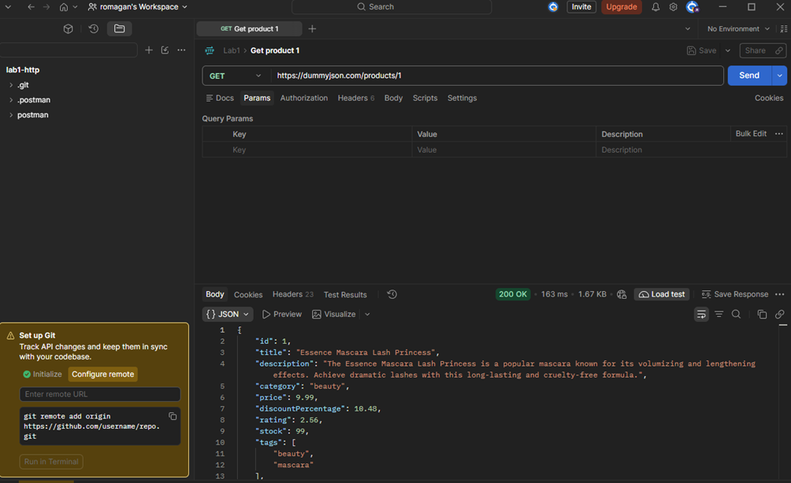

- **POST** `/products/add`: статус 201 Created, сервер повернув новий `id: 195` (316 ms, 1011 B).

- **PUT** `/products/1`: змінив `title`, у відповіді нове значення.

- **DELETE** `/products/1`: у відповіді `isDeleted: true`.

### DevTools (вкладка Network, запит `GET /products`)

| Параметр | Значення |
|---|---|
| Status Code | 200 OK |
| Remote Address | `[2606:4700:3031::ac43:cd2a]:443` (IPv6, Cloudflare) |
| content-type | `application/json; charset=utf-8` |
| date | Mon, 19 Oct 2026 09:29:17 GMT |
| server | cloudflare |
| etag | `W/"ac3a-Q0j5X7Zb/GG4CpZwhP3POutAwN4"` (слабкий валідатор) |
| accept-encoding | `gzip, deflate, br, zstd` |
| user-agent | `Mozilla/5.0 (Windows NT 10.0; Win64; x64) ... Chrome/155.0.0.0` |

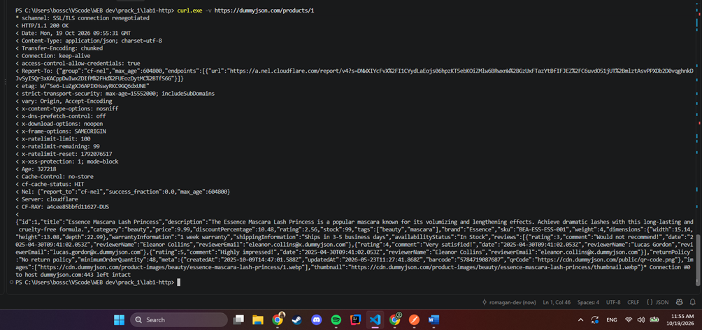
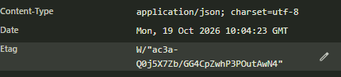
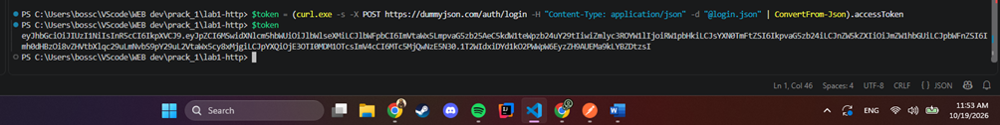

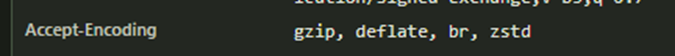
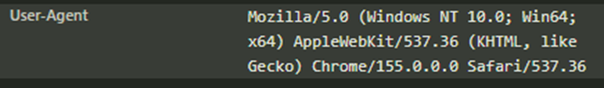

**Timing:** Queueing 1.20 ms, Stalled 0.96 ms, Request sent 1.57 ms, Waiting (TTFB) 40.62 ms, Content download 3.00 ms, разом 47.35 ms. DNS і Initial connection відсутні, бо браузер використав уже відкрите з'єднання. Основний час пішов на очікування сервера.
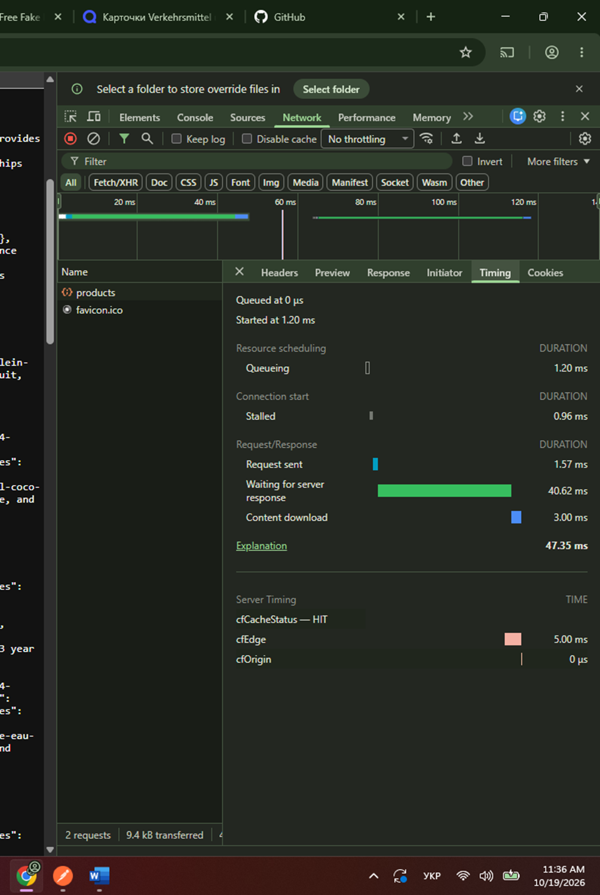

## Рівень 2. curl

У PowerShell використовував `curl.exe`. JSON у тілі запиту довелося передавати через файл (`-d "@post.json"`), бо PowerShell ламає лапки всередині рядка.

**GET зі списком користувачів**

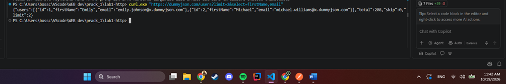

**POST** `/posts/add`: сервер повернув `id: 252`.

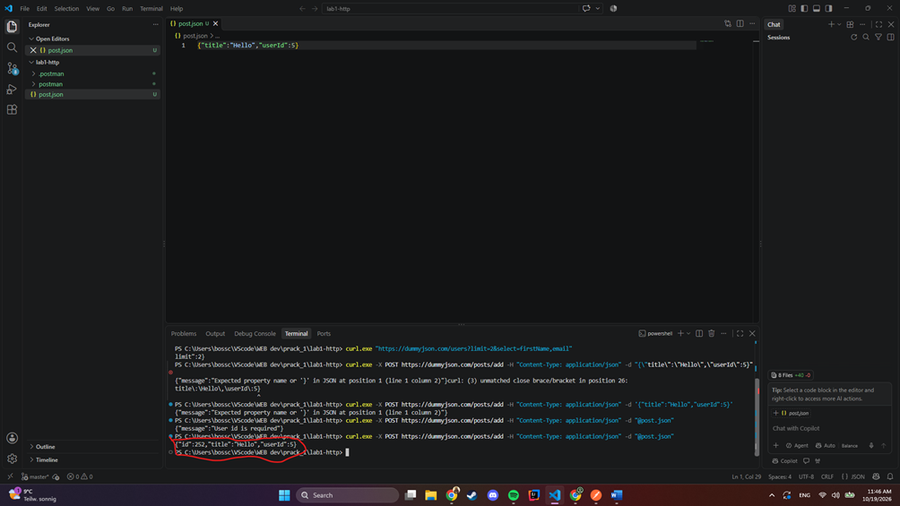

**Заголовки без тіла** (`-I`) для `/products`:

**Помилкові статуси** 404 і 500 (прапорець `-i`):
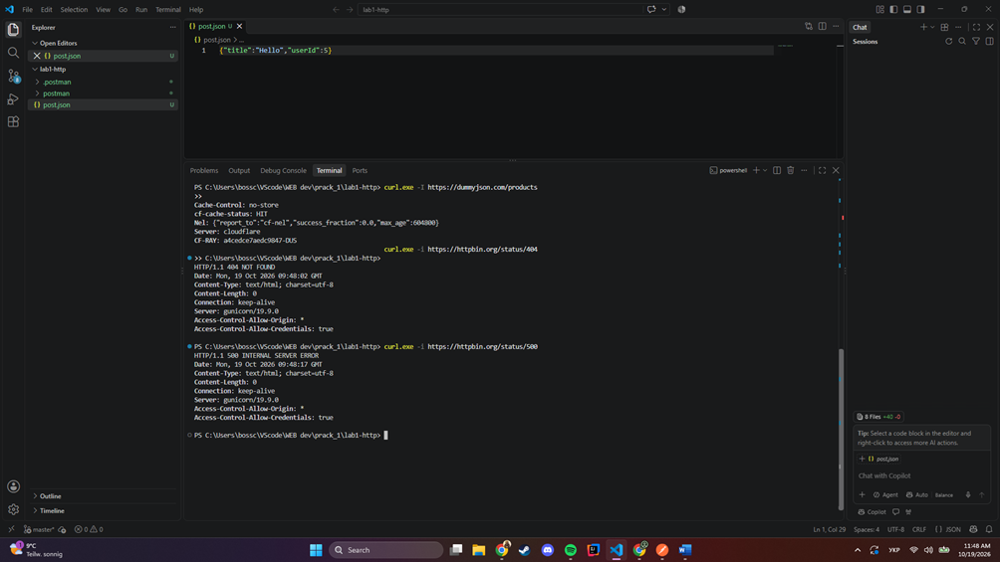

**Автентифікація.** Спочатку `POST /auth/login` (`emilys`), отримав `accessToken`. Потім передав його в заголовку `Authorization: Bearer <token>` до `/auth/me` і отримав дані користувача.
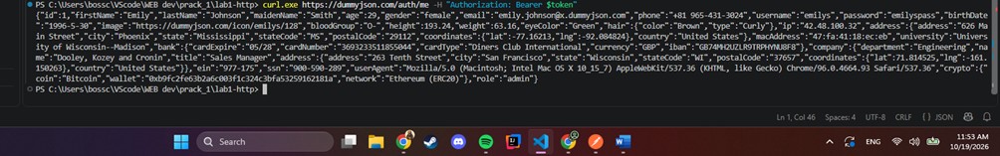

**Метрики часу** (`-w`): загальний час запиту близько 0.14 s.

## Рівень 3. TLS, Cookie, CORS

### TLS
`curl -v https://dummyjson.com/products/1` показав: ім'я зіставлено з IP, з'єднання на порт 443, ALPN обрав HTTP/1.1, сервер повернув `strict-transport-security`. На Windows curl використовує Schannel, тому деталі рукостискання (ClientHello, сертифікат) він не виводить.

TODO: сертифікат (видавець, термін, SAN), шифронабір, редірект HTTP → HTTPS.

### Cookie
Отримав cookies командою `curl.exe -c cookies.txt "https://httpbin.org/cookies/set?user_role=student&session_key=lab1_token"`, потім передав їх назад через `-b cookies.txt`. Сервер розпізнав обидві.
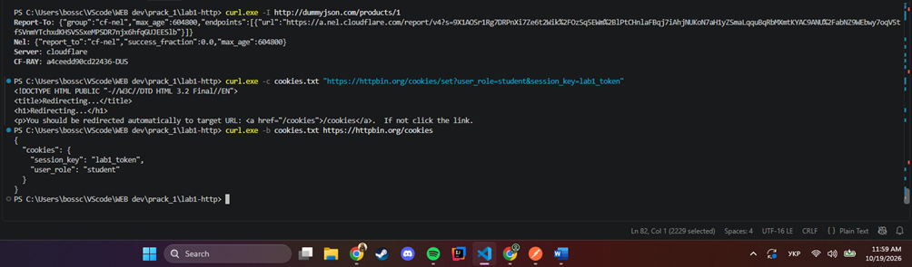

Файл Cookie Jar: [cookies.txt](cookies.txt)

TODO: заголовок Set-Cookie з атрибутами та пояснення:
- `HttpOnly` захищає від крадіжки cookie через XSS (JavaScript не бачить cookie);
- `Secure` не дає надсилати cookie по незахищеному HTTP;
- `SameSite` захищає від CSRF (міжсайтових запитів).

### CORS
TODO: preflight-запит (OPTIONS) до `httpbin.org/post`.

